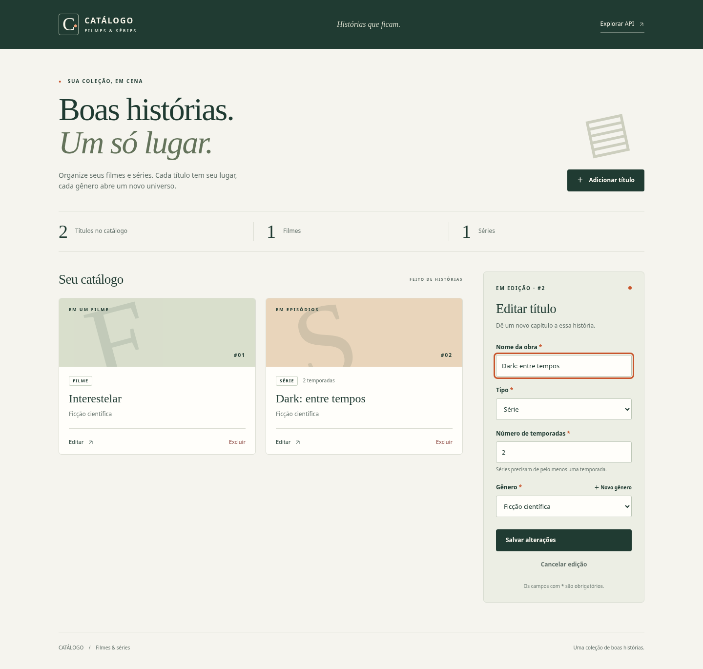
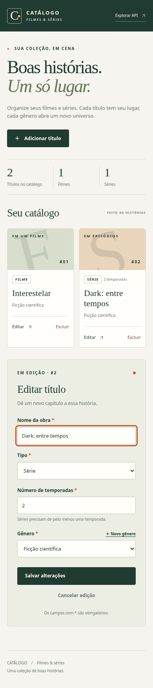

# Interface web complementar — Cadastro de filmes e séries

## Origem e contrato

Repositório da equipe: <https://github.com/Andsonyz/catalogo-filmes-series-api>, remoto `origin`. Branch padrão `main`, API integrada no merge `1c1815a2d8145dff2bb06a3c93823bd27f953cf0`, disponível na revisão `54493a6f5458e39a7238271904f7dc351322fcc4` usada como base de `feat/interface-catalogo`. A única alteração local preexistente era o SQLite migrado, mantido fora dos commits.

Lidos README, `config/urls.py`, serializers, viewsets, configurações e testes reais. A página consome GET/POST `/api/generos/`, GET/POST `/api/titulos/` e PATCH/DELETE `/api/titulos/{id}/`. Usa somente nome, tipo, gênero, temporadas e ID do modelo. As formas gráficas dos cartões são decorativas, não são pôsteres ou metadados inventados.

Implementação: `catalogo/views.py` entrega o template de `/catalogo/` e prepara o cookie CSRF com `ensure_csrf_cookie`. Endpoints são passados por `` no HTML. JS e CSS ficam nos arquivos estáticos do próprio app, servidos pelo runserver. Não há build, CDN, framework JS ou serviço externo.

## Regra e erros

Série exibe temporadas com `min=1`, `step=1` e preenchimento obrigatório; filme oculta e desabilita esse campo. O cadastro envia o valor nulo para filmes. Na edição, o PATCH envia somente campos alterados: mudar apenas o nome não envia temporadas; converter série em filme envia obrigatoriamente `tipo: filme` e `numero_temporadas: null` juntos. A API mantém a validação definitiva.

Erros de campo devolvidos pela API aparecem junto ao campo e recebem `aria-invalid`. Erros gerais/conexão são apresentados em mensagem legível; os valores preenchidos não são apagados. Botões de escrita ficam indisponíveis enquanto uma operação está pendente. A exclusão usa confirmação nativa e só remove o cartão após DELETE confirmado. O JS insere nomes com `textContent`/`Option`, sem interpolar conteúdo da API em HTML.

## Autenticação, CSRF e acessibilidade

A API mantém `AllowAny`; não se mudou a política ou o contrato. A página usa `credentials: same-origin`, aproveitando a sessão atual, e envia `X-CSRFToken` com o token oculto do template em POST/PATCH/DELETE. Não usa `csrf_exempt`, não armazena tokens de autenticação nem introduz login. O cenário completo foi realizado anonimamente e com sessão autenticada descartável; o cabeçalho CSRF real foi conferido no navegador.

Há rótulos visíveis, estados de carregamento/vazio/falha, link de salto, foco de teclado perceptível, mensagens `role=status`/`role=alert`, diálogo de gênero com foco nativo e suporte a Escape, e movimento reduzido quando solicitado. As larguras verificadas foram 1440×1060 e 390×844, sem rolagem horizontal. As capturas são da aplicação real com dados descartáveis.

## Verificação reproduzível

A execução da aplicação e os testes Django não precisam de Playwright. Para a verificação de navegador opcional, instale Playwright no ambiente usado para o script e um Chromium:

```bash
venv/bin/python -m pip install playwright==1.62.0
venv/bin/python -m playwright install chromium
# Terminal 1: banco e servidor exclusivamente descartáveis
venv/bin/python scripts/servir_interface_descartavel.py --port 8010
# Terminal 2, na raiz do projeto
CATALOGO_URL=http://127.0.0.1:8010 venv/bin/python scripts/verificar_interface.py
```

No PowerShell, use `.\venv\Scripts\python.exe` e defina `$env:CATALOGO_URL = 'http://127.0.0.1:8010'` antes de executar o script. `CATALOGO_CHROMIUM` pode apontar para um executável Chromium existente; na verificação desta etapa foi usado `/usr/bin/chromium`. `CATALOGO_CAPTURAS` altera o diretório de saída (padrão `docs/interface`). Não execute esse roteiro contra o banco usado pela equipe: ele exige catálogo inicialmente vazio e cria um gênero. Os títulos criados pelo roteiro são removidos em `finally`; no servidor descartável, gênero e demais dados somem ao encerrá-lo.

Comandos realmente executados nesta etapa:

```bash
# Configuração temporária equivalente ao launcher, em /workspace/scratch/interface-runtime:
PYTHONPATH=/workspace/scratch/interface-runtime:/workspace/catalogo-filmes-series-api venv/bin/python manage.py migrate --noinput --settings=interface_settings
PYTHONPATH=/workspace/scratch/interface-runtime:/workspace/catalogo-filmes-series-api venv/bin/python manage.py runserver 127.0.0.1:8000 --noreload --settings=interface_settings
python3 scripts/verificar_interface.py
# Rodada com sessão descartável criada no mesmo SQLite isolado:
CATALOGO_SESSAO=/workspace/scratch/interface-runtime/sessao.json python3 scripts/verificar_interface.py
# Verificação do launcher reproduzível, também com banco novo:
venv/bin/python scripts/servir_interface_descartavel.py --port 8010
# Check e testes no projeto:
venv/bin/python manage.py check
venv/bin/python -m pytest -v
node --check catalogo/static/catalogo/catalogo.js
git diff --check
```

A configuração temporária importa `config.settings` e substitui somente `DATABASES.default.NAME` por `/workspace/scratch/interface-runtime/db-interface.sqlite3`. A sessão foi criada via Django `Client.force_login()` para usuário descartável, com cookie fora do repositório e sem valor registrado. `CATALOGO_SESSAO` é uma opção exclusiva do roteiro de QA, não uma autenticação adicionada ao produto. A rodada final utiliza Chromium com Playwright **1.62.0**, em Linux. Não se afirma execução nativa em Safari, Firefox ou Windows.

## Resultados reais

| Cenário | Resultado observado |
| --- | --- |
| Página e catálogo vazio | GET 200; total 0; mensagem para iniciar a coleção; cookie CSRF presente |
| Cadastro de gênero pela tela | POST 201; diálogo fecha e novo gênero é selecionado |
| Cadastro de filme | POST 201; temporadas nulas |
| Cadastro de série | POST 201; duas temporadas persistidas |
| Validação de temporadas | HTML rejeita 0; ao remover somente `min` pelo roteiro, API retorna 400 real, erro aparece junto ao campo e preenchimento é preservado |
| Editar apenas nome da série | PATCH 200 com payload somente `nome`; GET confirma temporadas 2 |
| Converter série para filme | PATCH 200 com `tipo: filme` e `numero_temporadas: null`; GET e recarga confirmam filme sem temporadas |
| Cancelar exclusão | Registro permanece; GET 200 |
| Confirmar exclusão | DELETE 204; GET posterior 404; cartão removido após confirmação |
| Falha de conexão no envio | Mensagem de falha, preenchimento preservado, nenhum sucesso falso |
| Falha ao carregar e tentar novamente | Estado de erro exibido; retry recupera lista |
| Desktop e celular | Capturas reais; sem overflow horizontal; sem erros JavaScript |
| Sessão autenticada + CSRF | Mesmo fluxo completo aprovado com cookie de sessão e cabeçalho CSRF real |
| Teste Django sem cabeçalho CSRF, com sessão | Escrita rejeitada com 403 e nenhuma gravação |
| Teste Django com token da página, com sessão | Escrita aceita com 201 |
| Check Django / sintaxe JS | Sem problemas; códigos 0 |
| Suíte completa | 18 testes aprovados; apenas o aviso herdado de depreciação do pytz |

Logs: [rodada anônima](interface/cenarios-anonimos.log), [rodada final com sessão](interface/cenarios-navegador.log) e [comandos finais](interface/comandos.log). A primeira tentativa de QA teve timeout no seletor exato `get_by_label('Tipo', exact=True)`, porque o texto do rótulo também inclui a marca de obrigatório. Corrigido o seletor para busca parcial, sem alterar a regra da API. O erro original foi preservado em [primeira-verificacao.log](interface/primeira-verificacao.log); as rodadas seguintes completaram todos os cenários. Após a troca dos ícones por SVG local, o servidor sem autoreload foi reiniciado e as capturas finais foram renovadas.

O launcher descartável foi inicialmente tentado na porta 8001, ocupada por outro serviço deste ambiente (`Error: That port is already in use.`; a consulta HTTP nessa porta respondeu 401 desse serviço). Não se alterou nem se encerrou esse serviço. A alternativa `--port 8010` iniciou normalmente; o mesmo roteiro completo de navegador foi executado contra esse servidor novo e passou, como registrado em [cenarios-launcher.log](interface/cenarios-launcher.log). Essa colisão de porta foi uma limitação resolvida do ambiente, não uma falha da aplicação. O README e o roteiro de reprodução usam a porta 8010 para a demonstração descartável.

Não há cenário funcional solicitado pendente. A acessibilidade foi conferida nos elementos e no uso de teclado descritos, sem alegar auditoria completa por leitor de tela. As métricas acadêmicas anteriores continuam vinculadas às revisões expressamente identificadas nas evidências; não representam uma medição desta interface complementar.

O SQLite original da equipe manteve o SHA-256 `6e4b87abfa1f50121cd3a63866e8026e0ee5e4ee7600badc5c51a380bade7c10`. Nenhum registro preexistente foi usado ou alterado pelos cenários. Nenhuma migração de modelo foi necessária.

## Capturas reais





A alteração foi publicada em <https://github.com/Andsonyz/catalogo-filmes-series-api/pull/4>, de `feat/interface-catalogo` para `main`, com o título **Adiciona interface web ao catálogo de filmes e séries**. O GitHub confirmou `state: OPEN` e `mergedAt: null`. O PR deve permanecer aberto para revisão da interface; não foi realizado merge. Os servidores de QA foram encerrados, os dados/sessão descartáveis foram removidos e o servidor normal foi iniciado com `config.settings` em <http://127.0.0.1:8000/catalogo/>.
